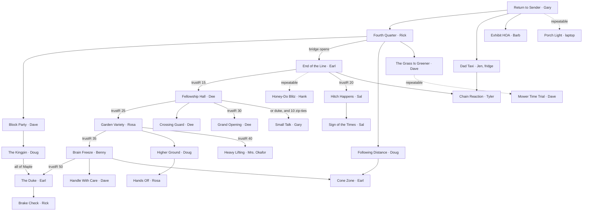

# Job unlock order (QA, all shipped jobs)

Generated from the `unlock` tables in `js/jobs/*.js` and the built-in gates in `index.html` (`jobLock`, `RIVER_TRUST_GATE`), and checked by playing the story with `node dev/givers-audit.js` (fresh save → finish one job at a time in story order → list every giver in the hub at each step).

Not shipped yet (stub files, not in the graph): Minivan Roundup (`roundup`), Good Fences (`heist`), Watch Your Step (`patrol`), Suds Up (`carwash`), Everybody Waves (`finale`).

## Graph

## Story walk (dev/givers-audit.js)

Trust per win as the game gives it (+16 Maple / +14 Riverside, or `def.winTrust`; jobs with `winTrust:0` that pay trust in small steps during play are counted as 0, the worst case).

| Step | Maple / Riverside trust | Unlocked and not done (repeatables included) |
|---|---|---|
| fresh | 12 / 5 | gary |
| gary | 28 / 5 | rick taxi hoa porch |
| rick | 44 / 5 | dave earl taxi mower hoa tail porch |
| dave | 60 / 5 | doug earl … |
| doug | 76 / 5 | earl … |
| earl | 76 / 19 | dee blitz … (tow needs trustR 20: opens after Dee, or after one Blitz) |
| dee | 76 / 33 | rosa tow crossing pawn … |
| rosa | 76 / 47 | benny overwatch moving … |
| benny | 76 / 61 | duke cargo … |
| duke | 76 / 75 | brake … **finale card fires here** |
| … every registered job … | | |
| last | 100 / 100 | blitz mowertt porch (repeatables) |

Every trust gate is met by the built-in Riverside chain alone, with margin: tow 20 (19 after Earl, 33 after Dee), pawn 30 (33), moving 40 (47), Dee/Rosa/Benny/Duke 15/25/35/50 (19/33/47/61). No circular gates.

## Flags

1. **Small Talk needs `prog.cuffed >= 10`** (and Dee or the Duke done). Zip-ties come from play (surrendered enemies in jobs, Riverside street trouble), so a player who shoots instead of cuffing, or turns street trouble to Calm, can finish everything else and never see Gary's job, with no hint why. It is satisfiable but invisible: the gate needs a hint (Gary in the hub: "Cuff a few more, then we'll talk") or a lower count.
2. **The finale card ("One month later") fires when the nine built-in jobs are done** (`wmAllDone` ignores registered jobs). In story order that is right after The Duke, with up to 16 registered story jobs still open, including Brake Check, which only unlocks after the Duke. "Keep driving" continues (`flags.finale2`), but "New Saturday" resets the built-in progress mid-story. The finale should wait for every shipped story job, or say there is more to do.
3. **One person, one place** (fixed in this pass): before, the hub put two Daves inside each other at Linden Park (Block Party + The Grass Is Greener on `g_dave`), two Dougs inside each other (The Kingpin + Following Distance on `g_doug`), and two Pastor Dees 8 m apart from Fellowship Hall onwards (Crossing Guard on `g_dee` + Grand Opening on the church sidewalk). Now a giver with several jobs offers them one at a time: built-in jobs first, then story before repeatables, then `def.order`. Queued jobs (in story order): Dee: Crossing Guard → Grand Opening; Dave: Block Party → Handle With Care → The Grass Is Greener → Mower Time Trial; Doug: The Kingpin → Following Distance → Higher Ground; Earl: End of the Line → The Duke → Cone Zone; Sal: Hitch Happens → Sign of the Times.
4. Repeatables (Blitz, Mower Time Trial, Porch Light) never take a giver's spot from a story job (they rank after every story job of the same person or spot).
